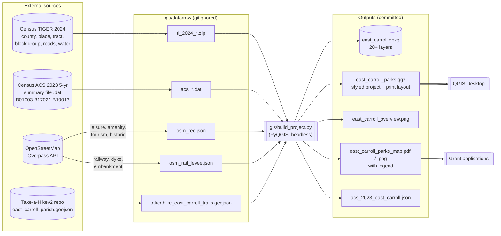
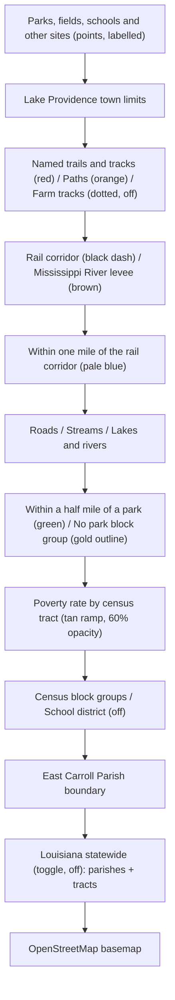
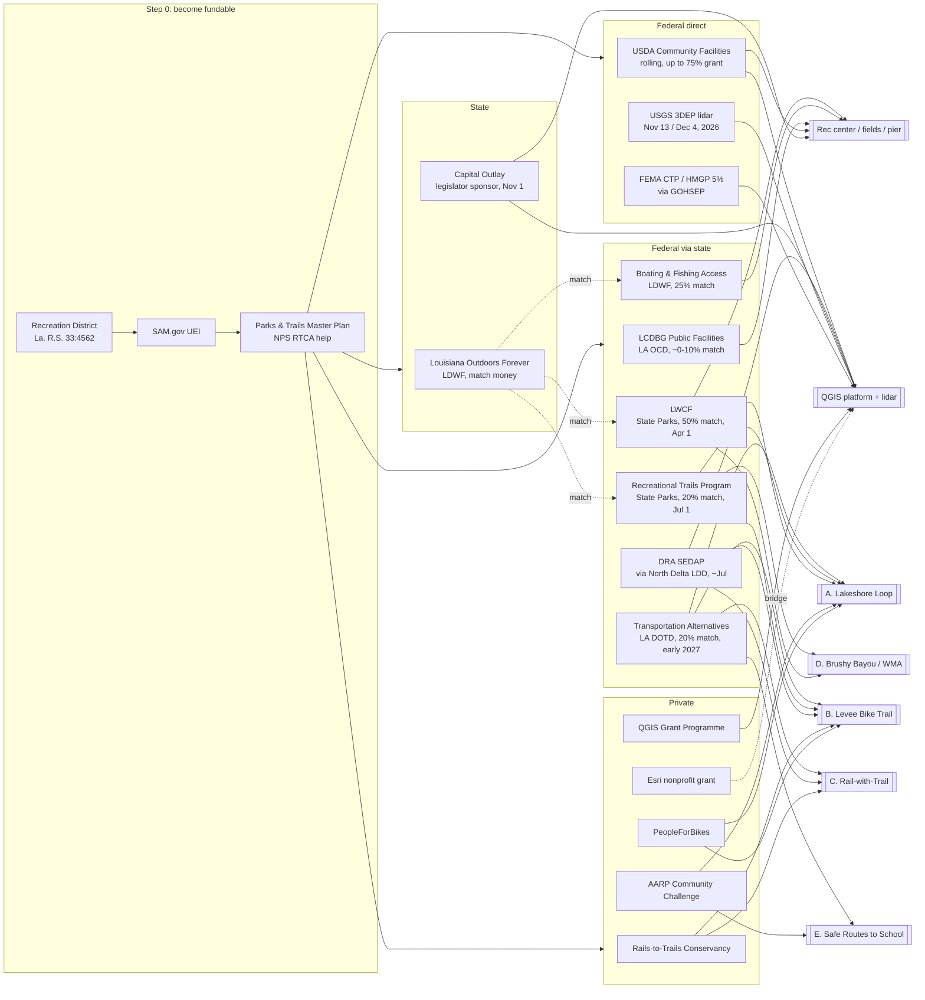
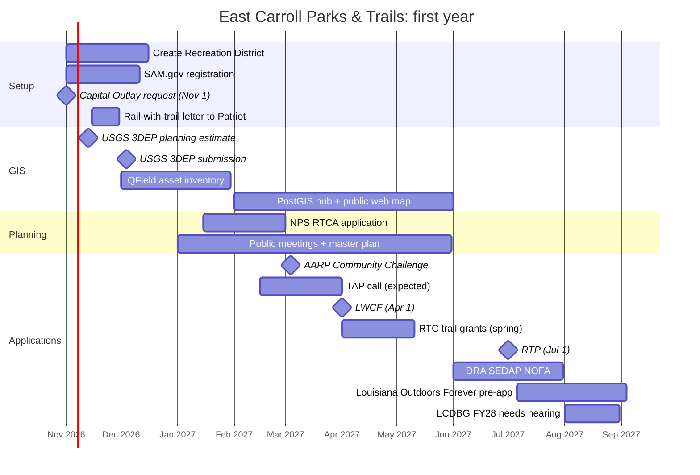

# How the Pieces Fit: Scripts and Funding

Mermaid diagrams render on GitHub. Open this file on github.com to see them drawn.

## 1. Data pipeline: raw downloads to QGIS project



## 2. Inside build_project.py

```mermaid
flowchart TD
    A[initQgis + Processing] --> B[Unzip TIGER shapefiles]
    B --> C[Extract parish 22035:<br/>boundary, tracts, block groups,<br/>roads, water, Lake Providence]
    C --> D[Read ACS .dat tables<br/>filter rows containing US22035]
    D --> E[Join population, median income,<br/>poverty_pct to tracts and block groups]
    E --> F[Statewide: all 64 parishes +<br/>1,388 LA tracts with poverty]
    F --> G[OSM points -> rec_assets<br/>collapse tags to asset_class]
    G --> H[Buffer parks 0.5 mi<br/>EPSG:26915 -> walkshed]
    H --> I[Block groups disjoint from walkshed<br/>-> no_park_access]
    I --> J[Clip Take-a-Hike lines to parish<br/>split: named / paths / tracks<br/>add length_km_clipped]
    J --> K[OSM rail + levee ways<br/>clip, length, 1 mi rail catchment]
    K --> L[Style every layer<br/>tan poverty ramp, asset classes,<br/>plain-English names]
    L --> M[Layer tree order<br/>points on top, basemap bottom<br/>statewide group unchecked]
    M --> N[Default view extent = parish]
    N --> O[Print layout: title, map,<br/>legend, scale bar, north arrow]
    O --> P[Export PDF + PNG<br/>write .qgz]
    P --> Q[Print summary stats<br/>exitQgis]
```



## 3. Layer stack as it draws in QGIS



## 4. Funding: who pays for what



## 5. Rail corridor decision tree

```mermaid
flowchart TD
    S[Lake Providence Line<br/>55 km, disused, owned by Delta Southern / Patriot Rail] --> Q1{Formally abandoned<br/>at the STB?}
    Q1 -- No (today) --> RWT[Ask Patriot Rail for a<br/>rail-with-trail license<br/>on 3-4 mi through town]
    RWT --> Q2{License granted?}
    Q2 -- Yes --> BUILD1[Design + fund with<br/>TAP / RTP / RTC / DRA]
    Q2 -- No --> ALT[Fall back to lakeshore loop<br/>and levee trail; keep monitoring<br/>STB docket FD 36443]
    Q1 -- Yes (future filing) --> RB[File railbanking request<br/>16 U.S.C. 1247(d)<br/>within the comment window]
    RB --> NITU[STB issues NITU /<br/>interim trail use order]
    NITU --> ACQ[Negotiate corridor transfer<br/>to Recreation District]
    ACQ --> BUILD2[Full rail-trail<br/>TAP + LWCF + RTP + DRA]
```

## 6. Twelve-month timeline


