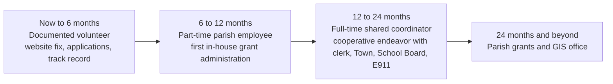

# Clerk of Court, Parish Technology, and Infrastructure Funding, plus a Path to a Parish Position

Prepared 2026-11-06. Extends `POLICE_JURY_PLAN.md`, which already covers parks, trails, GIS, and the main road and bridge programs (LCDBG, LWCF, RTP, TAP, USDA CF, DRA SEDAP, Capital Outlay, Parish Transportation Fund, LRSP, Off-System Bridge, SS4A, BUILD, FEMA, USGS 3DEP). This document adds three things:

1. **Clerk of Court funding:** money for the Clerk of Court's office.
2. **New Police Jury money:** technology, water, drainage, and capacity programs.
3. **A path to a paid job:** a realistic route to a full-time parish position funded largely by the grants it brings in.

The Clerk's website fix is in `CLERK_WEBSITE_ASSESSMENT.md`, and the draft site is in `clerk-site/`.

**Status flags used below.** **Open** means you can apply now. **Cycle** means the program recurs on a known schedule. **Paused** means there is no current funding or notice. **Cut** means the program was cancelled or rescinded. **[verify]** marks a fact this research could not confirm from a primary source. The federal landscape changed sharply in 2025 and 2026, so confirm with the agency before relying on any line.

---

## 0. Two prerequisites before any application

1. **Get the Police Jury's audit filed.** The East Carroll Banner reported on Sept. 15, 2026 that the Jury filed for an extension on its FY2025 audit, which was due June 30, 2026. **Update Nov. 9, 2026:** the Jury is not on the Legislative Auditor's non-compliance list generated Nov. 5, 2026, so the report was received or the extension approved. If the extended date passes without a report, the Jury goes on the list. "No state or federal funds passed through the state may be paid out" to an entity on that list. That would freeze LGAP, CWEF, the Water Sector Program, and capital outlay.
   - **FY2024 audit (LaPorte CPAs):** the federal single audit had zero findings. There were three state-law findings: vehicle-use reporting, missing or unpublished minutes, and missed ethics training.
   - **Other East Carroll bodies on the list:** the Communications District (E911), the Recreation District, and the Soil and Water Conservation District.
   - Full status table in `CLERK_FUNDING_OPTIONS.md` Section 3. [Non-compliance list CSV](https://app.lla.la.gov/LLANon-ComplianceList.nsf/LLAncrWebExport.csv) [Banner](https://www.eastcarrollbanner.com/news/police-jury-files-extension-audit-discusses-budget); [LLA consequences of a late report](https://lla.la.gov/resources/local-government-reporting/louisiana-governmental-audit-guide/500-1200-due-date-of-reports-and-consequences-of-a-late-report); [FY2024 single audit](https://fac.procurementexpress.com/audits/362634)
2. **Spend the remaining ARPA money by Dec. 31, 2026.** The deadline to obligate funds passed on Dec. 31, 2024. Only money already obligated can still be spent, and the spending deadline is Dec. 31, 2026. The Jury spent $410,371 of State and Local Fiscal Recovery Funds in 2024. Anything unspent after Dec. 31, 2026 goes back to Treasury. [UNC School of Government](https://canons.sog.unc.edu/blog/2026/01/16/2026-the-final-countdown-has-begun-for-arp-slfrf/)

---

## 1. Who's who

| Person | Office | Where | Notes |
|---|---|---|---|
| **Rene Thomas Williams** | Clerk of Court (elected; in office since January 2020 per the Clerks of Court Association listing; current term runs to Dec. 31, 2027 per BallotReady [verify]) | 400 First Street, Suite 3. (318) 559-2399, fax (318) 559-0037, rene.ecpclerk@bellsouth.net | Decides everything in the clerk's office: hiring, vendors, the website |
| **Renee B. Jones** | Registrar of Voters (a Secretary of State office) | Suite 7. (318) 559-2015, eastcarrollrov@sos.la.gov | **Your existing contact.** She and the clerk both sit on the parish board of election supervisors, so she is a natural introduction to the clerk |

Sources: [Clerks of Court Association directory](https://www.laclerksofcourt.org/clerks-of-court/); [BallotReady](https://www.ballotready.org/positions/louisiana-east-carroll-parish-court-clerk); [SOS voter portal](https://voterportal.sos.la.gov/Registrar); [U.S. Vote Foundation](https://www.usvotefoundation.org/east-carroll-parish-la-election-office); [R.S. 18:423](https://legis.la.gov/legis/Law.aspx?d=81559)

---

## 2. How the Clerk of Court's office works and is paid for

- **Duties.** The clerk is a constitutional officer elected for four years. The office is ex officio notary and parish recorder of conveyances and mortgages, and the clerk is the parish's chief election officer. [La. Const. Art. V §28](https://legis.la.gov/legis/Law.aspx?d=206466); [R.S. 13:751](https://www.legis.la.gov/legis/Law.aspx?d=78059); [R.S. 18:422](https://legis.la.gov/legis/Law.aspx?d=81558)
- **The office runs on its own fees.** Fees go into the Clerk's Salary Fund, which pays deputies and all office expenses. The clerk alone hires deputies and sets their pay. [R.S. 13:781](https://legis.la.gov/legis/Law.aspx?d=78083); [R.S. 13:783](https://legis.la.gov/legis/LawPrint.aspx?d=78085)
- **The Police Jury owes the office equipment.** The parish must provide the courthouse and the clerk's offices, furniture, and equipment. On the clerk's request it must also supply "all necessary office furniture, equipment, and record books." **This makes equipment and record books a Police Jury obligation, and it ties the two offices you are working with together.** [R.S. 33:4713, 33:4715, 13:784, summarized by the LLA (rev. 08/2026)](https://app.lla.la.gov/llala.nsf/883963BA21F0AF2A86258591005557F0/$FILE/Parish%20Obligations%20to%20Fund%20Other%20Public%20Officials.pdf)

**Latest audit found: fiscal year ended June 30, 2023** (unmodified opinion, no findings). [LLA report](https://app.lla.la.gov/publicreports.nsf/0/9e9019ebe1e9369686258ac90076b50f/$file/00003d22.pdf)

| Line | Amount |
|---|---|
| Revenue | **$500,801** |
| Court costs, fees, and charges | $274,197 |
| Recording fees | $83,260 |
| "Local funds" (source not stated) | $60,000 |
| Certified copies | $33,201 |
| Clerk's supplemental compensation | $25,800 |
| **State grant from the clerks' remote-access authority (LCRAA)** | **$23,320** |
| Spending | **$460,163**, of which personnel is $317,341 |
| Surplus / ending General Fund balance | $40,638 / $128,472 |
| Staff | About 4 employees |

The auditor's agreed-upon-procedures exceptions noted that the office had **no website** at the time. The office also had no individual cash drawers, no theft insurance, and old reconciling items. FY2024 and FY2025 clerk audits were not located [verify on the LLA site].

**What this means.** With about $40,000 of slack a year, the clerk cannot add a salaried position out of fees. Outside money has to come as project grants (Section 3) or through the Police Jury (Section 2 bullet above and Section 6).

**State changes that create work for the office (and openings for you)**
- **Act 694 of 2024:** every clerk must offer e-filing, e-recording, and remote access through the statewide portal (the clerks' remote-access authority, LCRAA) by **Jan. 1, 2026**. Whether East Carroll is fully compliant is unknown [verify; ask the clerk]. [Act 694](https://legis.la.gov/legis/ViewDocument.aspx?d=1382715); [R.S. 13:754](https://www.legis.la.gov/legis/Law.aspx?d=78062)
- **Act 446 of 2026 (HB 916):** adds a **$5 per-recording fee from Jan. 1, 2027** through Aug. 1, 2029, mostly to a Court Modernization and Technology Fund for statewide e-filing. The exact split was not confirmed from the enrolled text [verify]. [Bill history](https://legis.la.gov/legis/BillInfo.aspx?s=26RS&b=HB916&sbi=y)

---

## 3. Funding for the Clerk of Court's office

### 3a. Best fits, in priority order

| Pri | Program | Agency | Pays for | Match | Award | Status / next date | Source |
|---|---|---|---|---|---|---|---|
| 1 | **LCRAA grant** | La. Clerks' Remote Access Authority | Hardware, software, and services to **scan and index records onto the statewide portal**, e-transactions, emergency operations | None stated. Needs 2 vendor proposals and a financial needs assessment | East Carroll got **$23,320 in FY2023** (statewide total $478,074) | **Cycle:** quarterly, Jan. 31, Apr. 30, Jul. 31, Oct. 31. **Next: Jan. 31, 2027** | [Application](https://fluxconsole.com/files/item/505/182925/FINAL%20LCRAA%20GRANT%20APPLICATION%20-%20revised%20Dec%202023.pdf); [LCRAA audit](https://app.lla.la.gov/publicreports.nsf/0/ba77061dc3e6878486258a7c0070921c/$file/000035e7.pdf) |
| 1 | **Police Jury duty under R.S. 13:784 / 33:4713** | Police Jury | Office equipment and record books, on the clerk's request | n/a | Budget line | Annual Jury budget | [LLA summary](https://app.lla.la.gov/llala.nsf/883963BA21F0AF2A86258591005557F0/$FILE/Parish%20Obligations%20to%20Fund%20Other%20Public%20Officials.pdf) |
| 1 | **Louisiana Cybersecurity Assurance Program** | GOHSEP, La. National Guard, Office of Technology Services | **Free** vulnerability assessment, monitoring, incident response for local agencies | None | In-kind | Ongoing. Email LCAP@la.gov | [GOHSEP briefing](https://laregents.edu/wp-content/uploads/2024/11/GOHSEP-Cyber-Capabilities-BoR-6NOV24.pdf) |
| 1 | **CISA Cyber Hygiene scanning** | CISA | Free external vulnerability scans | None | Free | Ongoing. Email vulnerability@cisa.dhs.gov | [CISA](https://www.cisa.gov/cyber-hygiene-services) |
| 2 | **NEH Collections Stewardship** | National Endowment for the Humanities | Preservation, digitization, description | None | $50K to $500K | **Open: due Dec. 15, 2026.** Large and competitive; needs a humanities framing, such as historic Delta land and court records | [Grants.gov](https://simpler.grants.gov/opportunity/0dde865e-f4ba-4b19-8e14-b5b86cb7ccdc) |
| 2 | **State Justice Institute Technical Assistance** | SJI | Expert help on e-filing, **cybersecurity**, court operations | 50% (at least 20% cash) | Up to $75K | **Cycle:** Feb. 1, May 1, Aug. 1, 2027. Needs a Certificate of State Approval from the Louisiana Supreme Court. No salaries | [FY2027 guideline](https://public-inspection.federalregister.gov/2026-21505.pdf) |
| 2 | **STOP Violence Against Women Act grant** | Office on Violence Against Women through the La. Commission on Law Enforcement (LCLE) | Systems for tracking and transmitting **protective orders** (purpose area 4) | 25% | Varies | **Cycle:** 2026 notice posted July 2026 for 2027 awards; intent deadline comes from the LCLE district director | [2026 STOP notice](https://lcle.la.gov/wp-content/uploads/2026/07/2026-STOP-NOFO.pdf) |
| 2 | **Byrne JAG** (federal justice assistance grant) | LCLE planning district | Court technology (hardware, software) | None | Small | **Cycle.** The clerk likely applies through the Police Jury or the 6th Judicial District Court [verify] | [LCLE JAG](https://lcle.la.gov/wp-content/uploads/2025/07/BJAG-2024-Notice-of-Funding-Districts.pdf) |
| 3 | **NHPRC Archival Projects** | National Archives | Online access and digitization; explicitly encourages county and early legal records | None | Up to $150K | **Paused:** May 2025 round cancelled, no FY2027 call posted | [NHPRC](https://www.archives.gov/nhprc/announcement/archival.html) |
| 3 | **NEH Preservation Assistance Grants** | NEH | Preservation assessment, disaster plan, rehousing | None | Up to $10K | **Paused:** Jan. 2026 round closed, next not confirmed | [Listing](https://grantexec.com/grants/fe4d6e1a-b935-4a77-9b2f-07c95cf0afe0) |
| 3 | **CLIR Digitizing Hidden Collections** | Council on Library and Information Resources | Digitizing records of under-documented communities | Not stated | $50K to $300K | **Cycle:** next about fall 2027. A government applicant must confirm eligibility with CLIR first; partnering with a university is safer | [CLIR](https://www.clir.org/hiddencollections/apply-for-an-award/) |
| 3 | **NCHIP / NARIP** (criminal history records) | Bureau of Justice Statistics through LCLE and the Supreme Court case management system | Disposition reporting | 10% | Statewide | **Indirect only:** state agencies apply. Ask the Supreme Court's case management office about local help | [BJS](https://bjs.ojp.gov/programs/national-criminal-history-improvement-program/state-profiles) |

**Not a source:** HAVA election-security money goes to Secretary of State equipment, not to clerks ([EAC narrative](https://www.eac.gov/sites/default/files/paymentgrants/Election%20Security/narrative2023/LA_2023_ES_State_Narrative_Budget.pdf)). The State Archives' imaging is a paid service, not a grant ([SOS](https://www.sos.la.gov/archives/imaging-preservation-services)).

### 3b. Projects to offer the clerk, and what pays for each

| Project | What it costs the office | Pays for it |
|---|---|---|
| **Fix and rebuild the website** (see `clerk-site/`) | Volunteer time; hosting free | Nothing needed. Optional free `.gov` domain from CISA |
| Back-index and scan conveyance and mortgage books onto eClerksLA | Vendor or project staff | **LCRAA grant (Jan. 31, 2027)**; NEH Collections Stewardship for the oldest books |
| Confirm and finish the Act 694 e-filing / e-recording setup | Vendor configuration, training | LCRAA (it is required to help members); SJI technical assistance |
| Off-site backup and disaster recovery for land records | Hardware or cloud service | LCRAA ("emergency operations" is eligible); free state cyber assessment first |
| Cybersecurity check of office computers | None | Free LCAP assessment plus CISA scanning |
| Records-room preservation (humidity, shelving, boxes) | Small | Police Jury under R.S. 13:784; NEH Preservation Assistance if it reopens |
| Protective-order processing system | Software, process | STOP VAWA, 25% match |
| Fix the audit's agreed-upon-procedures exceptions (cash drawers, insurance, reconciliations) | Mostly process | Office budget; makes later grant applications cleaner |

---

## 4. New Police Jury funding: technology

| Pri | Program | Agency | Pays for | Match | Award | Status / next date | Source |
|---|---|---|---|---|---|---|---|
| 1 | **Free cyber services** (LCAP, CISA Cyber Hygiene) | State / CISA | Assessments, scans, monitoring | None | Free | Ongoing | See Section 3a |
| 1 | **Comply with Act 239 of 2026 (SB 75)** | GOHSEP | Not a grant. GOHSEP will set cyber standards for local governments; entities that don't meet them must **reimburse the state for incident response, estimated at about $527K per incident** | n/a | n/a | Effective Aug. 1, 2026; draft rules out for parish comment | [SB 75](https://legiscan.com/LA/text/SB75/2026) |
| 1 | **Emergency Management Performance Grant (EMPG) and the FY26 emergency operations center (EOC) grant** | FEMA through GOHSEP | Emergency management operations; EOC technology, backup power, communications | About 50% | Small (the Jury spent $5,284 of EMPG in 2024) | **Cycle:** FY26 notices went to parish directors June 2026. Personnel costs may become ineligible around FY2028 | [GOHSEP June 2026 minutes](https://wwwcfprd.doa.louisiana.gov/boardsandcommissions/MeetingMinutes/348_Regional%20Directors%20Meeting%20minutes-%20June%202026.pdf) |
| 2 | **E-Rate for the parish library** | FCC / USAC | 20% to 90% discount on library internet and Wi-Fi | Remainder | Formula | **Cycle:** FY2027 window expected mid-January 2027. Hotspot lending was dropped Sept. 30, 2025 | [E-Rate dates](https://nlcblogs.nebraska.gov/nlcblog/2025/12/18/e-rate-form-471-fy2026-application-filing-window-dates-announced/) |
| 2 | **911 surcharge for next-generation 911 (Act 947 of 2026, HB 463)** | Communications district | NG911 upgrades, including GIS addressing | n/a | Fee revenue | Law lets the district fund NG911; final fee cap not confirmed [verify] | [HB 463](https://www.legis.la.gov/legis/ViewDocument.aspx?d=1486874) |
| 2 | **Community Project Funding / Congressionally Directed Spending** (federal earmarks) | Rep. Letlow, Sens. Cassidy and Kennedy | The only live route to COPS technology money; also works for 911, radios, water, Corps projects | Varies | Earmark | Requests typically go in February to April | [COPS 2026](https://cops.usdoj.gov/pdf/2026ProgramDocs/tep/solicitation.pdf) |
| 3 | **USDA Distance Learning and Telemedicine** | USDA Rural Utilities Service | Video and telehealth equipment for the library, schools, the hospital district | About 15% | About $27M pool nationally | **Cycle:** FY26 closed June 30, 2026; next usually spring | [Federal Register](https://www.federalregister.gov/documents/2026/05/07/2026-08991/notice-of-funding-opportunity-for-the-distance-learning-and-telemedicine-grant-program-for-fiscal) |
| 3 | **Assistance to Firefighters Grant** | FEMA | Fire equipment, radios | 5% for communities under 20,000 | Varies | **Cycle:** FY2026 expected in 2027 | [FEMA](https://content.govdelivery.com/accounts/USDHSFEMA/bulletins/41c55c0) |
| 3 | **State and Local Cybersecurity Grant Program (SLCGP)** | CISA/FEMA through GOHSEP | Cyber planning and mitigation | 40%, rising | Up to $200K per application | **Paused:** Louisiana local rounds closed June 30, 2026; no FY2026 federal appropriation. Keep a project ready for when it returns | [GOHSEP minutes](https://wwwcfprd.doa.louisiana.gov/boardsandcommissions/MeetingMinutes/348_Regional%20Directors%20Meeting%20minutes-%20June%202026.pdf); [S.3251](https://www.congress.gov/bill/119th-congress/senate-bill/3251/all-info) |
| — | **Cut or not useful:** NTIA Digital Equity (cancelled May 2025; the competitive program may reopen December 2026); MS-ISAC (now a paid membership); Energy Efficiency and Conservation Block Grant (ended June 30, 2026); FirstNet (a service, not a grant) | | | | | | [NACo](https://www.naco.org/news/ntia-terminates-digital-equity-act-grants); [Benton](https://www.benton.org/blog/commerce-targets-december-2026-reopen-digital-equity-competitive-grants) |

**Broadband in East Carroll today:**
- A $4M state GUMBO grant went to Conexon in 2022. Fiber reached the library and rural homes, but the in-town build stalled over a reimbursement dispute with the state.
- Conexon's $6.2M federal BEAD award for East Carroll was rescinded, and that money went to SpaceX (Starlink).
- **What to do:** press ConnectLA to get the in-town fiber finished. That is advocacy, not a grant application. [GovTech](https://www.govtech.com/network/in-rural-louisiana-fiber-internet-project-hits-speedbump); [KNOE](https://www.knoe.com/2022/10/06/state-rejects-sparklights-protest-gumbo-grant-east-carroll-parish/)

---

## 5. New Police Jury funding: water, drainage, and infrastructure

| Pri | Program | Agency | Pays for | Match | Award | Status / next date | Source |
|---|---|---|---|---|---|---|---|
| 1 | **LGAP** (Local Government Assistance Program) | Office of Community Development, Local Government Assistance | Roads, drainage, fire and police equipment, government buildings, water and sewer. **Recreation is ineligible** | None | Parish allocation **$60,000** (FY25-26); cap $100,000 | **Cycle:** last window ran Nov. 3, 2025 to Feb. 28, 2026. FY26-27 window not yet posted [verify]. Needs a Jury resolution plus letters from the state senator and representative | [LGAP](https://doa.louisiana.gov/doa/ocd-lga/lgap-and-cwef-programs/local-government-assistance-program/) |
| 1 | **CWEF** (Community Water Enrichment Fund) | Same office | Community water system repair and construction | None | Parish allocation **$156,000**; cap $100,000 per application | Same cycle as LGAP | [CWEF](https://doa.louisiana.gov/doa/ocd-lga/lgap-and-cwef-programs/community-water-enrichment-fund) |
| 1 | **Louisiana Water Sector Program** | Office of Community Development / Water Sector Commission | Water and sewer repair, consolidation | **25%, waivable** if requested in the application | Up to $5M | **Cycle:** FY26-27 guidance approved; dates not posted. **Applicants on the LLA non-compliance list are barred.** Pairs with the Lake Providence sewer project already in the 2026 capital outlay bill (HB2) | [Water Sector](https://locd.la.gov/local-government-assistance/water-sector-program) |
| 1 | **DOTD Statewide Flood Control, Rural Grant Opportunity** | DOTD Public Works | Drainage construction, **up to 100%** for authorities under 50,000 people | 0% to 10% | Varies | **Cycle:** pre-application May 1, application Oct. 1 (2020 guidelines; confirm current dates) | [Rural Grant Opportunity](https://dotd.la.gov/about/office-of-project-delivery/engineering/public-works/public-works-programs-projects/statewide-flood-control/rural-grant-opportunity-program) |
| 2 | **USDA Rural Development Water and Waste Disposal** | USDA RD | Water, sewer, storm drainage, solid waste (loan plus grant) | Grant share depends on income | Varies | **Open:** rolling. Persistent-poverty status favors a high grant share. The state office helps with packaging | [RHIhub](https://www.ruralhealthinfo.org/funding/4163) |
| 2 | **EDA Public Works / Economic Adjustment** | U.S. Economic Development Administration | Job-linked roads, water, sewer, resilience | 50% base, higher in distressed areas | $600K to $5M | **Open:** rolling FY2025 joint notice. The project must be in North Delta's 2026-2030 regional economic strategy (CEDS). Partner with the Port Commission, which already has two EDA awards | [Grants.gov](https://simpler.grants.gov/opportunity/b5365cea-b07c-4e8d-8313-e23ab0fd3766); [North Delta CEDS](https://northdelta.org/2025/10/02/document-for-review-ceds/) |
| 2 | **DRA Community Infrastructure Fund** | Delta Regional Authority | Water, sewer, flood control, transportation, broadband | Varies | $250K to $1M | **Cycle:** 2026 round closed Aug. 24, 2026; next likely mid-2027. Prepare engineering this winter | [2026 notice](https://links.communityforce.com/dra/CIF2026NOFA.pdf) |
| 2 | **Corps of Engineers small projects** (Section 205 flood control; Section 14 streambank) | USACE | Small flood control, emergency streambank protection | 35% after a partly federal study | Section 14 up to $15M | **Open:** starts with a sponsor letter to the Corps district (likely Vicksburg [verify]) | [CRS](https://www.everycrsreport.com/files/2026-09-01_IF12635_a23e474eb73d5e65f328dfe9041f3bbcf18b8389.html) |
| 3 | **Drinking Water and Clean Water revolving funds** | LDH / LDEQ (EPA money) | Water and sewer loans, some forgiven | Loan | Varies | **Open.** Much of the FY2026 money went to earmarks, so less is available to lend | [ASDWA](https://www.asdwa.org/2026/01/20/congress-approves-fy-2026-interior-and-environment-appropriations-bill/) |
| 3 | **NRCS Emergency Watershed Protection** | USDA NRCS | Debris and channel repair after disasters | About 25% | Varies | After disasters | [DOTD/USDA brief](https://dotd.la.gov/media/iwbn3exn/usda-presentation_current_authority_aug2026.pdf) |
| 3 | **USDA Solid Waste Management grants** | USDA RUS | Technical assistance only (landfill planning, waste reduction), for the Garbage District | n/a | About $4M national pool | **Cycle:** FY27 window Oct. 1 to Dec. 31, 2026 (aggregator detail [verify]). Low fit | [USDA fact sheet](https://rd.usda.gov/sites/default/files/fact-sheet/508_RD_FS_RUS_SolidWasteMgmtGrants.pdf) |
| — | **Port Priority Program** (DOTD, up to 90% state share) | | | | | The **Port Commission** applies, not the Jury. Quarterly: Mar. 1, Jun. 1, Sep. 1, Dec. 1 | [DOTD](https://dotd.la.gov/about/office-of-multimodal-commerce/ports-and-waterways/ports/port-priority-program) |

**Capacity and planning money**
- **DRA Strategic Planning:** $25K to $150K for distressed-parish plans. No 2026 round confirmed; contact strategy@dra.gov. Use it for a parish capital and technology plan. [DRA](https://dra.gov/applications-open-for-dras-2025-strategic-planning-program/)
- **Louisiana Main Street / Lagniappe Community Program:** an 18-month path to Main Street designation for the Town of Lake Providence, then $2,500 to $10,000 restoration grants. Contact the Lt. Governor's office. [KEDM](https://www.kedm.org/louisiana-news/2025-10-08/lagniappe-community-program-accepts-new-member)
- **Cut:** USDA Rural Community Development Initiative (FY2025 notice rescinded); USDA Community Facilities Technical Assistance (closed). [RHIhub](https://www.ruralhealthinfo.org/news/38724)

---

## 6. Money already moving in East Carroll

Use these to show the Jury and the clerk that the parish can win and manage awards.

**Police Jury federal spending (single audits)**
- FY2024: $2.64M with **0 findings**. That covers Section 8 vouchers, LCDBG, ARPA ($410,371), the Local Assistance and Tribal Consistency Fund ($100,000), and EMPG.
- FY2023: $1.46M.
- [Federal Audit Clearinghouse](https://fac.procurementexpress.com/orgs/49009)

**2026 state capital outlay (Act 4, HB2) East Carroll sheet**
Amounts are approximate because the table extracts poorly. Much of it is authorized but not yet cash-funded.
- **East Carroll Parish Courthouse assessment and restoration, about $10.1M.** This matters to both the clerk and the Jury, since the Jury must provide the courthouse.
- Lake Providence sewer improvements, about $1.74M.
- Lake Providence Lake spillway repairs and outfall canal cleaning.
- Sheriff's training and recreation center, about $12M.
- Multi-parish Mississippi River levee raising.
- [HB2 East Carroll](https://www.house.louisiana.gov/housefiscal/HB2LOCBYPARISH_ALL/HB2LOCBYPARISH_2627/HB2%20East%20Carroll.pdf)

**Federal highway money through DOTD**
- Lake Providence Sidewalks Phase I: $206,593 obligated Sept. 16, 2026.
- Henderson Loop Road bridge over Wildcat Bayou, about $245K.
- LA 585 Drainage Canal bridge, about $2.1M.
- [USAspending](https://www.usaspending.gov/award/ASST_NON_693JJ22630000Y308LAH015952_069)

**Port Commission:** $380,000 EDA Public Works grant (2023) for a third lane on the port road, plus $250,000 for the Northeast Louisiana Regional Rail and Port Master Plan. [USAspending](https://www.usaspending.gov/award/ASST_NON_080205709_013)

**Clerk of Court:** the $23,320 LCRAA grant (FY2023).

**Other state money:** $20,000 to the Jury for road repairs (2025 Act 461, HB 460). [Act 461](https://www.legis.la.gov/legis/ViewDocument.aspx?d=1426038)

---

## 7. A path to a full-time parish position

### 7a. What the rules say

- **No single program pays for a parish grants coordinator.** The job gets paid for by stacking four sources:
  - administration allowances inside grants the parish wins
  - staff time charged to planning grants
  - a salary shared across offices
  - a general-fund share
- **The rules favor hiring an employee over a consultant:**
  - LCDBG lets a grantee administer the grant with **its own staff**. The admin line is **$35,000** for requests up to $600K, **$40,000** above that, and **$20,000** if the parish has another open LCDBG grant. Past cycles gave bonus points for paying admin locally. [2023 LCDBG Grantee Handbook](https://www.doa.la.gov/media/c44e0u3q/lcdbg-grantee-handbook-2023_final_v3.pdf)
  - Every federal-aid road or trail project through DOTD (TAP, LRSP) must name a **full-time employee** of the parish as "responsible charge." **A part-time contractor cannot fill that role.** [DOTD form](https://dotd.la.gov/media/frphlw30/responsible-charge-form-for-dotd-held-contracts.doc); [LTAP local public agency (LPA) training](https://www.ltrc.lsu.edu/ltap/lpa-training.html)
- **FEMA hazard mitigation:** the parish can claim up to 5% of a subaward for its own management costs, including staff time. [FEMA](https://www.fema.gov/sites/default/files/2020-07/hmgp_management_costs_hma_guidance_crosswalk.pdf)
- **Federal indirect costs:** the de minimis rate rose to **15%** for awards made on or after Oct. 1, 2024. It applies to direct costs other than equipment and construction, so construction grants recover little. [DOE guidance](https://www.energy.gov/sites/default/files/2024-07/OCED_De-MinimisIndirectCostRate%2007292024.pdf)
- **TAP pays nothing for administration.** All of that time is a parish cost. [DOTD TAP guide](https://dotd.la.gov/media/fqzb5oyn/2025-dotdtap-application-guide-002.pdf)
- **A position shared across offices is legal and has a template:**
  - La. R.S. 33:1324.1 lets political subdivisions "combine the use of administrative and operative personnel" on agreed compensation. [R.S. 33:1324.1](https://legis.la.gov/legis/Law.aspx?d=89037)
  - A cooperative endeavor agreement under La. Const. Art. VII §14(C) can cover the Police Jury, the Clerk of Court, the Town, the School Board, and E911. The Division of Administration publishes a template. [CEA template](https://doa.la.gov/media/mjgpylgs/cea-template-10-30-24.docx)
  - One office must be the legal employer, and the others reimburse it.
  - *Model from another parish, for comparison only:* Lincoln Parish runs a GIS District whose board includes its clerk of court, police jury, school board, assessor, sheriff, and 911 commission. [Lincoln Parish GIS board](https://www.lincolnparish.gov/node/3856)

### 7b. Paying for it (illustrative)

| Line | Per year |
|---|---|
| **Cost:** salary $55,000 + Parochial Employees' Retirement 11% + FICA 7.65% + health about $9,000 | **About $74,000** |
| Two LCDBG grants administered in-house ($35K to $40K each over a 2 to 3 year grant life) | $25,000 to $35,000 |
| Hazard mitigation management costs on about $1M of projects | $15,000 to $25,000 |
| Staff time charged to planning grants (EDA, DRA, SS4A if Congress renews it) | $0 to $15,000 |
| Cooperative endeavor shares from the clerk, Town, School Board, E911 | $15,000 to $30,000 |
| Police Jury general fund | The remainder |

**Talking point for the Jury:** Louisiana parishes have paid consultants $34,650 to $40,700 to administer a single LCDBG grant. Concordia Parish paid $34,650 in 2015 and Acadia Parish $40,700 in 2010. An in-house coordinator keeps that money in the parish. [Concordia minutes](https://www.conppj.org/uploads/4/4/1/3/44133479/_minutes_10-12-15.pdf); [Acadia minutes](https://appj.org/wp-content/uploads/2022/12/regPJmtg_jan122010.pdf)

**The catch:** admin money arrives only after awards are made, so year one needs local cash.

**Pay benchmarks:**
- Assumption Parish approved a full-time grants coordinator at **$65,000 to $70,000** in March 2026. [Notice](https://louisianapublicnotice.com/notices/603171)
- Louisiana grant writers average about $56,500. [ZipRecruiter](https://www.ziprecruiter.com/Salaries/Grant-Writer-Salary--in-Louisiana)
- A realistic East Carroll range is probably $42,000 to $60,000. That is an estimate; no East Carroll posting was found.
- Police Jury employees join Parochial Employees' Retirement (Plan A: 9.5% employee, 11% employer). [DOA rates](https://www.doa.louisiana.gov/media/ws0hocb4/fy2627a_ret_rates.pdf)

### 7c. Ethics: what to do and not do (get a written opinion)

- **Volunteers count.** Louisiana's ethics code treats a supervised volunteer as a public employee "whether compensated or not." [R.S. 42:1102](https://legis.la.gov/legis/Law.aspx?d=99214)
- **No contracts while you volunteer.** A public servant may not enter a contract under their agency's supervision (R.S. 42:1113A).
- **Two-year bar on contracting afterward.** For two years after leaving, you cannot sell the same services back to the agency by contract (R.S. 42:1121B).
- **So become an employee, not a contractor.** Moving from volunteer to employee is the clean path; moving from volunteer to contractor is the risky one.
- **Don't draft or push the resolution that creates your own job or sets your pay.** That would be a transaction in which you have a substantial economic interest (R.S. 42:1112A). Let the Jury act on its own.
- **Don't take pay** from firms or nonprofits that have or seek contracts or grants with the Jury (R.S. 42:1111C).
- **Get a written opinion first.** Before any paid arrangement, request an **advisory opinion from the Louisiana Board of Ethics** at (225) 219-5600. [Ethics Code summary](https://ethics.la.gov/Pub/Laws/ethsum.pdf)
- **Training once hired:** 1 hour of ethics training and 1 hour of sexual harassment prevention training each year. [R.S. 42:343](https://legis.la.gov/legis/Law.aspx?d=1107429)

### 7d. Phases

| Phase | What has to be true |
|---|---|
| **0. Now to about 6 months: volunteer** | Appointed by Jury resolution so the role is on record. Ethics opinion requested. Training done. A log of every application, dollars awarded, and consultant fees avoided. No contracts with the Jury or the clerk. Clerk's website fixed. |
| **1. About 6 to 12 months: part-time employee** | The Jury creates the position on its own initiative. At least one LCDBG or hazard mitigation award names in-house administration. LTAP LPA core training complete, so you can serve as responsible charge once full-time. |
| **2. About 12 to 24 months: full-time shared coordinator** | A cooperative endeavor agreement with cost shares. One employer of record. At least half of the roughly $74,000 cost covered by admin allowances and partner shares. |
| **3. 24 months and beyond** | A parish grants and GIS office, with AmeriCorps VISTA support if federal funding holds (FY2027 is uncertain). |

**Credentials worth getting**
- LTAP LPA Core Training (free, and the most useful for road and trail money)
- OCD's LCDBG grantee workshops (Louisiana has no LCDBG administrator certification)
- GISP or Grant Professional Certified later; both require years of experience first

**Benchmark for a first year:** one rural county's (Logan County, Ky.) full-time grant writer, hired in July 2025, brought in $284,940 across 10 awards in about 14 months. [Franklin Favorite](https://www.franklinfavorite.com/russellville/russellville/news/article_c57bca7f-5a0d-5c61-a7d7-f43241fdb2b0.html) No rural Louisiana example with documented results was found; **your own log will be the strongest evidence.**

---

## 8. Next six months

| When | Action | Who |
|---|---|---|
| Now | Ask Mrs. Jones (Registrar) for an introduction to the clerk | You |
| Now | Show the clerk the website assessment and draft; ask who holds the GoDaddy login | You, Clerk |
| Now | Ask the Jury about its audit extension and its plan for remaining ARPA money (deadline Dec. 31, 2026) | You, Secretary-Treasurer |
| November 2026 | Enroll the Jury and the clerk in CISA Cyber Hygiene; request free LCAP assessments | Jury, Clerk |
| November 2026 | Watch for the FY26-27 LGAP and CWEF window; line up legislator letters | Jury |
| December 2026 | Division resolution (from `POLICE_JURY_PLAN.md`); add a resolution recording your volunteer role | Jury |
| Dec. 15, 2026 | NEH Collections Stewardship, only if the clerk wants a large historic-records project | Clerk |
| January 2027 | E-Rate FY2027 window for the library | Library |
| **Jan. 31, 2027** | **LCRAA grant: scanning and indexing onto eClerksLA** | Clerk |
| February to April 2027 | Federal earmark requests (COPS technology, 911, water) to Rep. Letlow and Sens. Cassidy and Kennedy | Jury |
| Feb. 1, 2027 | SJI Technical Assistance, if e-filing or cybersecurity help is needed | Clerk, 6th Judicial District Court |
| Rolling | USDA RD water and waste; EDA Public Works with the Port Commission; Corps small-project sponsor letter | Jury |
| Mid-2027 | DRA Community Infrastructure Fund; Statewide Flood Control (pre-application May 1) | Jury |
