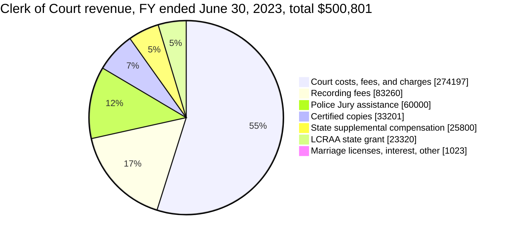
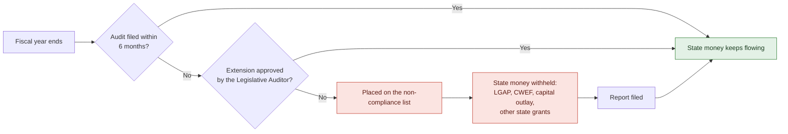
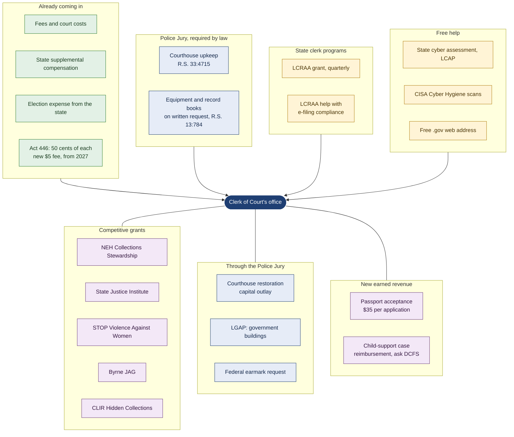
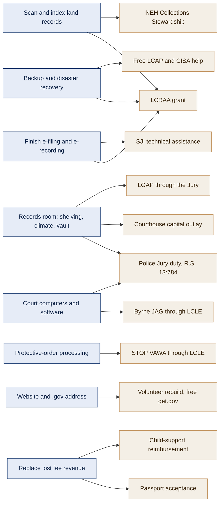
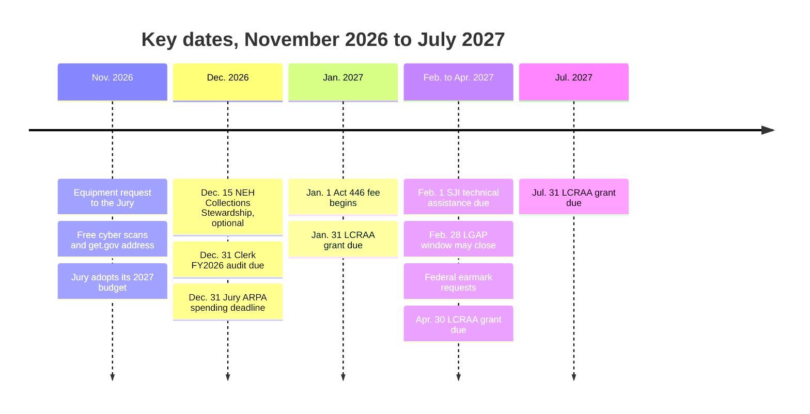

# Funding Options for the East Carroll Parish Clerk of Court

Prepared for **Rene Thomas Williams, Clerk of Court**, East Carroll Parish. November 9, 2026.

This briefing lists every source of money and free help we found for the Clerk of Court's office: grants, state programs, Police Jury obligations, free services, and new earned revenue. It also answers one question directly: **is any money being withheld from the Police Jury or the Clerk's office?**

**How to read the status column.**
- **Open:** apply any time.
- **Cycle:** recurs on a known schedule.
- **Ask:** depends on a phone call or a written request.
- **Paused:** no funding right now. Keep a project ready.

**[verify]** marks a fact that could not be confirmed from a primary source. Federal programs changed a great deal in 2025 and 2026, so confirm each line with the agency before relying on it. The companion document `CLERK_AND_PARISH_FUNDING.md` has the longer research.

---

## 1. At a glance

- **No money is being withheld from the Police Jury or the Clerk's office.** Neither is on the Legislative Auditor's non-compliance list. The list was generated Nov. 5, 2026. Three other East Carroll bodies are on it (Section 3).
- **The office runs on fees, and fees fell.** Court costs dropped from $330,421 in FY2022 to $274,197 in FY2023, a 17% decline. The Police Jury covered the gap with $60,000 at the Clerk's request.
- **Best near-term money:** the state clerks' remote-access grant (**LCRAA**), next due **Jan. 31, 2027**. It paid the office $23,320 in FY2023.
- **The Police Jury owes the office equipment by law.** On the Clerk's written request, the Jury must supply office furniture, equipment, and record books (R.S. 13:784). The request should reach the Jury while its 2027 budget is being set.
- **Free help is available now:** cybersecurity assessments from the state and CISA, plus a free `.gov` web address.
- **One deadline protects all of the above:** the office's FY2026 audit is due to the Legislative Auditor by **Dec. 31, 2026**.

---

## 2. Where the office's money comes from today

Latest audit found online: fiscal year ended June 30, 2023 (unmodified opinion, no findings).

| Item | FY2022 | FY2023 | What it means |
|---|---|---|---|
| Court costs, fees, and charges | $330,421 | $274,197 | Down 17%. The East Carroll Banner reported the loss came partly from companies such as John Deere moving clerical work away from the office |
| Recording fees | $80,350 | $83,260 | Steady |
| Certified copies | $18,319 | $33,201 | Up 81% |
| Police Jury ("local funds" in the audit) | none | $60,000 | Requested by the Clerk and approved by the Jury |
| State grants | $7,530 | $23,320 | The FY2023 amount was the LCRAA grant, so the office has already won this grant |
| General Fund balance at year end | $87,834 | $128,472 | About $40,000 of slack a year. Not enough to fund a new position from fees |
| Staff | | 4 employees | |

Sources: [Clerk FY2023 audit](https://app.lla.la.gov/publicreports.nsf/0/9e9019ebe1e9369686258ac90076b50f/$file/00003d22.pdf); [East Carroll Banner, Dec. 28, 2023](https://www.eastcarrollbanner.com/news/government-wins-and-challenges).

---

## 3. Is money being withheld? The Police Jury check

**What withholding means in Louisiana.** Every local government must file its audit within six months of its fiscal year end (R.S. 24:513). An entity that misses the deadline without an approved extension goes on the Legislative Auditor's **non-compliance list**. Under R.S. 39:72.1, **state money cannot be paid to an entity on that list.** It comes off the list when the report arrives or an extension is approved.

### Status as of the Nov. 5, 2026 list

| East Carroll entity | On the list? | Detail |
|---|---|---|
| **Police Jury** | **No** | The FY2025 audit was due June 30, 2026. The Jury filed for an extension (Banner, Sept. 15, 2026). Because it is not on the list, the report has either been received or the extension was approved. **Ask the Secretary-Treasurer which, and the new due date.** If that date passes without a report, state money stops, including the courthouse capital outlay |
| **Clerk of Court** | **No** | The FY2024 and FY2025 reports were not found online, but the office is not listed, so the Auditor has them or approved extensions [verify]. **FY2026 report due Dec. 31, 2026** |
| Sheriff | No | FY2025 report is on file |
| **Communications District (E911)** | **Yes, 3 years** | Reviews missing for FY2023, FY2024, and FY2025. State money is blocked, which matters for any next-generation 911 or shared-staff plan |
| **Recreation District** | **Yes** | FY2024 sworn financial statements missing (due Mar. 31, 2025) |
| **Soil and Water Conservation District** | **Yes** | FY2026 sworn financial statements missing (due Sept. 30, 2026) |

Source: [Legislative Auditor non-compliance list (CSV export)](https://app.lla.la.gov/LLANon-ComplianceList.nsf/LLAncrWebExport.csv); [consequences of a late report](https://lla.la.gov/resources/local-government-reporting/louisiana-governmental-audit-guide/500-1200-due-date-of-reports-and-consequences-of-a-late-report).

### Is the Police Jury holding back money owed to the Clerk?

No sign of it in the public record.
- **Courthouse costs:** the Clerk's audit states the Police Jury pays the cost of maintaining and operating the courthouse, as R.S. 33:4715 requires.
- **2023 assistance:** the Jury approved the Clerk's $60,000 request.
- **Criminal court costs:** the Jury paid $1,460 in FY2023; the Sheriff paid $38,454.

Three things are worth watching:
1. **Courthouse maintenance tax.** The Jury's FY2024 audit lists the 2.53-mill courthouse maintenance tax with an expiration of 2024. If it was not renewed, courthouse upkeep now competes with everything else in the General Fund. **[verify the renewal]**
2. **Tight Jury finances.** The FY2024 audit shows the General Fund and Road Fund over budget, and a $7,787 deficit in the Criminal Court Fund. On April 21, 2026 the Banner reported jurors had gone four months without financial statements at committee meetings. Full statements were back by July 2026.
3. **FY2024 audit findings (Jury, not Clerk).** Federal programs were clean. Three state-law findings were reported:
   - vehicle-use reporting
   - minutes from June to September 2024 missing or unpublished
   - required ethics and harassment training not taken

   The "adverse" opinion in that report covers only the Jury's choice to leave the Sheriff, Assessor, Clerk, and other separately elected offices out of its statements. It does not concern the Clerk's money.

Sources: [Police Jury FY2024 audit](https://app.lla.la.gov/publicreports.nsf/0/917d9b4069d3afdc86258cc200514172/$file/00007fa9.pdf); [Banner, Sept. 15, 2026](https://www.eastcarrollbanner.com/news/police-jury-files-extension-audit-discusses-budget); [Banner, Apr. 21, 2026](https://www.eastcarrollbanner.com/news/police-jury); [Banner, July 21, 2026](https://www.eastcarrollbanner.com/news/police-jury-operating-full-financials).

---

## 4. The full funding map

Top: money and help the office already has or is owed. Bottom: money the office can go after.

---

## 5. Every option, by type

### 5a. Money the office already receives or is owed

| Source | What it is | Size | Status |
|---|---|---|---|
| Fees, court costs, recording (R.S. 13:781) | Go into the Clerk's Salary Fund, which pays staff and office costs | About $391,000 in FY2023 | Ongoing |
| State supplemental compensation | Paid by the state | $25,800 | Ongoing |
| Election expense | The state pays the Clerk for election duties | $1,800 in FY2023 | Ongoing |
| [Act 446 of 2026 (HB 916)](https://legis.la.gov/legis/BillInfo.aspx?s=26RS&b=HB916&sbi=y) | A new $5 fee for statewide e-filing. **The Clerk keeps 50 cents of each fee**, LCRAA keeps 50 cents, and the rest goes to a state court technology fund | Small but recurring | Starts Jan. 1, 2027 [verify]; ends Aug. 1, 2029 unless extended |
| **Police Jury: courthouse** (R.S. 33:4715) | The Jury maintains and operates the courthouse and the office space | Jury budget | Ongoing |
| **Police Jury: equipment and record books** (R.S. 13:784, 33:4713) | On the Clerk's request, the Jury must provide "all necessary office furniture, equipment, and record books" | Jury budget | **Ask: send a written list before the 2027 Jury budget is adopted** |

Source for the Jury duties: [Legislative Auditor, Parish Obligations to Fund Other Public Officials](https://app.lla.la.gov/llala.nsf/883963BA21F0AF2A86258591005557F0/$FILE/Parish%20Obligations%20to%20Fund%20Other%20Public%20Officials.pdf).

### 5b. State clerk programs

| Program | Pays for | Size / match | Next date | Status |
|---|---|---|---|---|
| [**LCRAA grant**](https://fluxconsole.com/files/item/505/182925/FINAL%20LCRAA%20GRANT%20APPLICATION%20-%20revised%20Dec%202023.pdf) (Louisiana Clerks' Remote Access Authority) | Hardware, software, and services to scan and index records onto the statewide portal; e-transactions; emergency operations | Office got $23,320 in FY2023. No match stated. Needs 2 vendor proposals and a financial needs assessment | **Jan. 31, 2027**, then Apr. 30, Jul. 31, Oct. 31 | **Cycle** |
| LCRAA compliance help (Act 694 of 2024) | Every clerk had to offer e-filing, e-recording, and remote access by Jan. 1, 2026. LCRAA supports members in getting there | In-kind | Now | **Ask** whether any piece is unfinished |

### 5c. Free help, no application fee or match

| Program | What you get | How to start |
|---|---|---|
| Louisiana Cybersecurity Assurance Program (GOHSEP, National Guard, Office of Technology Services) | Free vulnerability assessment, monitoring, incident response | Email LCAP@la.gov |
| [CISA Cyber Hygiene](https://www.cisa.gov/cyber-hygiene-services) | Free weekly external scans of the office's internet-facing systems | Email vulnerability@cisa.dhs.gov |
| [.gov domain](https://get.gov/) | A trusted official web address for the office's site at no cost | Request through get.gov |
| Website rebuild | A draft replacement site is ready for the office's review | Volunteer; see `clerk-site/` |

**Not a source, so skip these:**
- HAVA election-security money goes to the Secretary of State, not to clerks.
- State Archives imaging is a paid service, not a grant.
- MS-ISAC is now a paid membership.

### 5d. Competitive grants

| Program | Pays for | Size / match | Next date | Status |
|---|---|---|---|---|
| [NEH Collections Stewardship](https://simpler.grants.gov/opportunity/0dde865e-f4ba-4b19-8e14-b5b86cb7ccdc) | Preserving and digitizing historic records, such as early Delta land and court books | $50K to $500K. No match | **Dec. 15, 2026** | **Open.** Large and competitive; best with a university partner |
| [State Justice Institute Technical Assistance](https://public-inspection.federalregister.gov/2026-21505.pdf) | Expert help on e-filing, cybersecurity, court operations | Up to $75K. 50% match, at least 20% cash. No salaries | Feb. 1, May 1, Aug. 1, 2027 | **Cycle.** Needs Louisiana Supreme Court approval |
| [STOP Violence Against Women](https://lcle.la.gov/wp-content/uploads/2026/07/2026-STOP-NOFO.pdf) (through LCLE) | Systems to track and transmit protective orders | Varies. 25% match | Through the LCLE district director | **Cycle** |
| [Byrne JAG](https://lcle.la.gov/wp-content/uploads/2025/07/BJAG-2024-Notice-of-Funding-Districts.pdf) (through LCLE) | Court technology, hardware, software | Small. No match | Through the LCLE district | **Cycle.** May go through the Jury or the 6th Judicial District Court [verify] |
| [CLIR Digitizing Hidden Collections](https://www.clir.org/hiddencollections/apply-for-an-award/) | Digitizing records of under-documented communities | $50K to $300K | About fall 2027 | **Cycle.** Partner with a university |
| [NHPRC Archival Projects](https://www.archives.gov/nhprc/announcement/archival.html) | Online access to county and early legal records | Up to $150K | None posted | **Paused** |
| NEH Preservation Assistance | Preservation assessment, disaster plan, supplies | Up to $10K | None posted | **Paused** |
| State and Local Cybersecurity Grant Program | Cyber planning and fixes | Up to $200K. 40% match | None posted | **Paused** |

### 5e. Through the Police Jury (the Jury applies, the office benefits)

| Program | How it helps the Clerk's office | Status |
|---|---|---|
| [2026 capital outlay, East Carroll Courthouse assessment and restoration](https://www.house.louisiana.gov/housefiscal/HB2LOCBYPARISH_ALL/HB2LOCBYPARISH_2627/HB2%20East%20Carroll.pdf), about $10.1M | Engineers are weighing renovation against a new building ([KNOE, Dec. 2025](https://www.knoe.com/2025/12/10/after-years-non-compliance-east-carroll-parish-courthouse-is-inching-closer-with-an-upcoming-accessibility-overhaul/)). **Make sure the records vault, climate control, shelving, and an accessible public counter are in the scope** | Authorized; not all cash-funded. Depends on the Jury staying off the non-compliance list |
| [LGAP](https://doa.louisiana.gov/doa/ocd-lga/lgap-and-cwef-programs/local-government-assistance-program/) (Local Government Assistance Program) | "Government buildings" are eligible, so records-room improvements can be included. Parish allocation $60,000, cap $100,000, no match | **Cycle.** Last window Nov. 3, 2025 to Feb. 28, 2026. Next not yet posted [verify]. Needs a Jury resolution and letters from the state senator and representative |
| Federal earmark (Community Project Funding / Congressionally Directed Spending) | Records digitization or courthouse work as a named project | Requests usually go to Rep. Letlow and Sens. Cassidy and Kennedy, February to April |
| USDA Community Facilities | Courthouse buildings and equipment in rural areas | Nearly all FY2026 grant money was earmarked [verify]. Use the earmark route instead |

### 5f. New earned revenue

| Idea | How it works | Status |
|---|---|---|
| **Passport acceptance facility** | Clerk's offices across Louisiana accept passport applications for the U.S. Department of State. **The facility keeps the $35 execution fee** on each new application. Requires State Department designation and agent training | **Ask** whether the office already offers it [verify]. The draft website does not list it |
| **Child-support case reimbursement (Title IV-D)** | Louisiana law lets a court enter a cooperative agreement with the Department of Children and Family Services on child-support collections and costs (R.S. 46:236.11). Federal Title IV-D money reimburses part of that work | **Ask** DCFS Child Support Enforcement whether the office's child-support work qualifies [verify] |

---

## 6. Which source fits which project

---

## 7. Calendar

---

## 8. Suggested first steps

| # | Step | Who | When |
|---|---|---|---|
| 1 | Confirm the FY2026 audit is on track for Dec. 31, 2026 | Clerk, auditor | Now |
| 2 | Send the Police Jury a written list of needed equipment and record books under R.S. 13:784 | Clerk | Before the 2027 Jury budget is adopted |
| 3 | Sign up for the free CISA scans and LCAP assessment; request a `.gov` address | Office, with volunteer help | November |
| 4 | Gather two vendor proposals for scanning and indexing; prepare the LCRAA application | Volunteer drafts, Clerk signs | Due Jan. 31, 2027 |
| 5 | Ask the Jury to name the Clerk's records vault and public counter in the courthouse restoration scope | Clerk | Next Jury meeting |
| 6 | Call about passport acceptance and child-support reimbursement | Office | December |
| 7 | Decide on NEH Collections Stewardship. Go only with a university partner | Clerk | By Dec. 1 |

**What I can do at no cost to the office:**
- draft the LCRAA application and the equipment request
- collect vendor quotes
- handle the cybersecurity sign-ups
- finish the website
- keep this calendar

The Clerk makes every decision and signs everything.

---

## 9. Questions to confirm with the office

1. Is every part of the Act 694 e-filing, e-recording, and remote-access setup working?
2. Were the FY2024 and FY2025 audits filed, and who is doing the FY2026 audit?
3. Has the office received LCRAA grants since FY2023? How much, and for what?
4. Has the Police Jury ever been asked in writing for equipment under R.S. 13:784? Is anything owed to the office now?
5. Was the courthouse maintenance tax renewed?
6. Does the office accept passport applications?
7. Is there a child-support (IV-D) cooperative agreement in place?
8. Who holds the login for the website domain?

---

## Sources

- Clerk of Court FY2023 audit: [Legislative Auditor](https://app.lla.la.gov/publicreports.nsf/0/9e9019ebe1e9369686258ac90076b50f/$file/00003d22.pdf)
- Police Jury FY2024 audit (LaPorte CPAs, June 20, 2025): [Legislative Auditor](https://app.lla.la.gov/publicreports.nsf/0/917d9b4069d3afdc86258cc200514172/$file/00007fa9.pdf)
- Non-compliance list, generated Nov. 5, 2026: [CSV export](https://app.lla.la.gov/LLANon-ComplianceList.nsf/LLAncrWebExport.csv)
- Late-report rules (R.S. 24:513, R.S. 39:72.1): [Legislative Auditor guide](https://lla.la.gov/resources/local-government-reporting/louisiana-governmental-audit-guide/500-1200-due-date-of-reports-and-consequences-of-a-late-report)
- Parish obligations to other officials (R.S. 13:784, 33:4713, 33:4715): [Legislative Auditor](https://app.lla.la.gov/llala.nsf/883963BA21F0AF2A86258591005557F0/$FILE/Parish%20Obligations%20to%20Fund%20Other%20Public%20Officials.pdf)
- East Carroll Banner: [Dec. 28, 2023](https://www.eastcarrollbanner.com/news/government-wins-and-challenges), [Apr. 21, 2026](https://www.eastcarrollbanner.com/news/police-jury), [July 21, 2026](https://www.eastcarrollbanner.com/news/police-jury-operating-full-financials), [Sept. 15, 2026](https://www.eastcarrollbanner.com/news/police-jury-files-extension-audit-discusses-budget)
- KNOE, courthouse accessibility, Dec. 10, 2025: [article](https://www.knoe.com/2025/12/10/after-years-non-compliance-east-carroll-parish-courthouse-is-inching-closer-with-an-upcoming-accessibility-overhaul/)
- Act 446 of 2026 (HB 916): [bill history](https://legis.la.gov/legis/BillInfo.aspx?s=26RS&b=HB916&sbi=y)
- Act 694 of 2024: [text](https://legis.la.gov/legis/ViewDocument.aspx?d=1382715)
- LCRAA grant application: [form](https://fluxconsole.com/files/item/505/182925/FINAL%20LCRAA%20GRANT%20APPLICATION%20-%20revised%20Dec%202023.pdf)
- 2026 capital outlay, East Carroll: [HB2 sheet](https://www.house.louisiana.gov/housefiscal/HB2LOCBYPARISH_ALL/HB2LOCBYPARISH_2627/HB2%20East%20Carroll.pdf)
- Grant programs: links in each table row above
