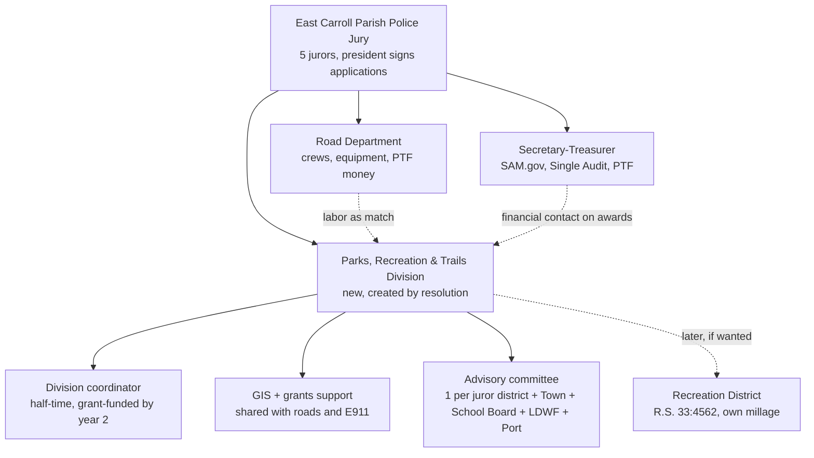
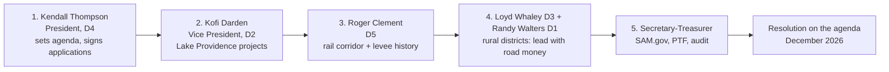
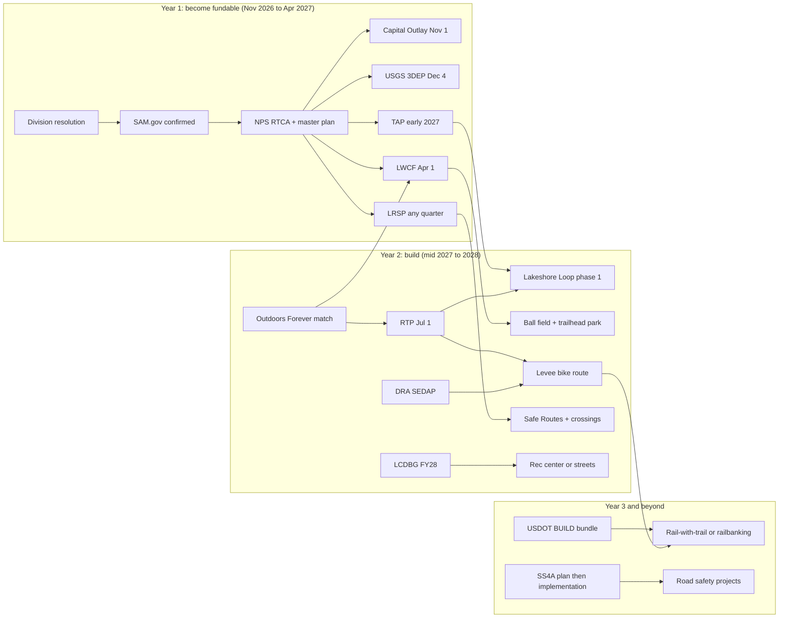
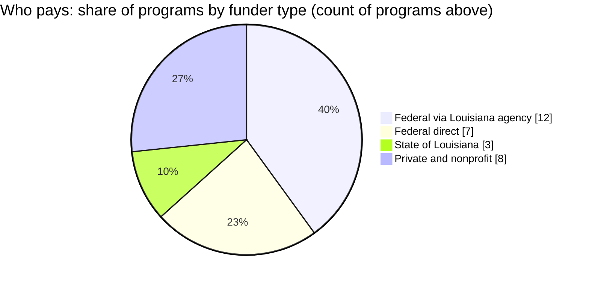
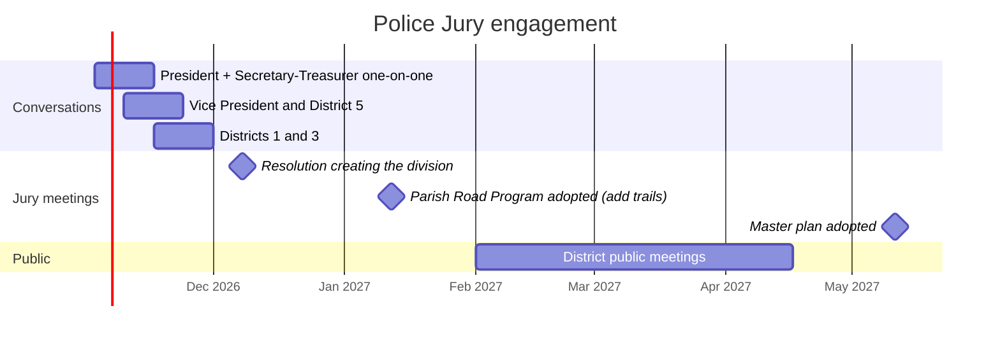

# Parks, Recreation and Trails as a Division of the East Carroll Parish Police Jury

Prepared 2026-10-29. This is the political and organizational plan, with the complete funding list. `FUNDING_ROADMAP.md` and `TRAILS_PLAN.md` carry program detail and sources; `ARCHITECTURE.md` has the technical diagrams.

## 1. Why a Police Jury division rather than a separate district

The Police Jury already has the legal standing, a SAM.gov history (it receives federal awards and files a Single Audit), road crews, and equipment. Making parks and trails a division of the Jury means:

- Grant applications go out under the Jury's existing registrations, so nothing waits on a new entity.
- The Road Maintenance and Construction fund's crews and equipment can build trail base, clear corridors, and maintain trailheads, and that labor counts as local match.
- Road and trail money can be pursued together. Most trail programs (TAP, LRSP, Safe Routes) are transportation money that a road department already understands.
- A recreation district under La. R.S. 33:4562 can still be created later if the Jury wants a dedicated millage, and the division's track record makes that vote easier.

**Jury actions needed, in order:**

1. Resolution creating the division and naming a juror as liaison (one meeting).
2. Resolution authorizing the president to sign grant applications and designating the secretary-treasurer as financial contact for federal awards.
3. Resolution adopting the parks and trails master plan once NPS RTCA helps draft it (spring 2027).
4. Annual budget line for the division, even if small, because every state program asks for evidence of local commitment.

## 2. Who to talk to

### Police jurors (five single-member districts, terms January 2024 through December 2027)

| District | Juror | Role | Source |
|---|---|---|---|
| 1 | Randy E. Walters | Juror; unopposed in 2023 | KNOE unopposed list, Aug 2023 |
| 2 | Kofi N. Darden | Vice president | KNOE primary results, Oct 2023; East Carroll Banner |
| 3 | Loyd "Mookie" Whaley | Juror; committee role | KNOE primary results, Oct 2023 |
| 4 | Kendall L. Thompson | **President**, fourth consecutive term; active in the Police Jury Association of Louisiana | KNOE; lpgov.org |
| 5 | Roger Odell Clement | Juror; committee role; named in the Port Commission rail case, so he knows the rail corridor history | KNOE; La. 2d Cir. 2025 |

Officers were re-elected unchanged in January 2025 per the East Carroll Banner. Confirm the current slate at the first meeting you attend.

**Order of conversations:**

1. **Kendall Thompson (President).** He sets the agenda and signs applications. Bring the one-page summary (`docs/ONE_PAGER.pdf`), the map PDF, and the ask: a resolution creating the division.
2. **Kofi Darden (Vice President, District 2).** District 2 covers part of Lake Providence, where the lakeshore loop and Safe Routes projects land.
3. **Roger Clement (District 5).** Rail corridor and levee history; needed on board for any rail-with-trail approach.
4. **Loyd Whaley and Randy Walters.** Rural districts. Lead with road and bridge money (Section 4) and the levee trail.
5. **Secretary-treasurer / parish administrator.** Name not published online; ask at the office. This person runs the Parish Transportation Fund, the Single Audit, and SAM.gov, and will be the financial contact on every award.

### Police Jury office

- 400 First Street, Lake Providence, LA 71254. Phone (318) 559-2256. Confirm the monthly meeting date by phone; the East Carroll Banner covers meetings.
- Audited funds as of FY 2022 (Louisiana Legislative Auditor): General, Road Maintenance and Construction, Garbage District No. 1, Library, Drainage Maintenance. **There is no recreation fund today**, which is the opening for this division.

### Other local decision-makers

| Who | Why |
|---|---|
| Mayor and Board of Aldermen, Town of Lake Providence | Lakeshore loop, sidewalks, and Safe Routes are inside town limits. Joint applications score better. |
| Lake Providence Port Commission (Wyly Gilfoil, named in the 2025 case) | Holds the rail interest; must endorse any rail-with-trail approach. |
| Northeast Louisiana Railroad Development District: Jim Lensing and Karvan Powell are the East Carroll appointees | Regional rail policy; their endorsement frames the trail as compatible with rail restoration. |
| Fifth Louisiana Levee District | Controls the Mississippi River levee crown road; recreational use permission under La. R.S. 38:301 series. |
| East Carroll Parish School Board | Safe Routes to School, shared use of fields and gyms. |
| LDWF Bayou Macon WMA manager | Trail connector and birding trail. |
| North Delta Regional Planning and Development District (Monroe) | Writes LCDBG and DRA applications for member parishes; the DRA Local Development District. |
| State representative and state senator for East Carroll | Capital Outlay sponsor (requests due November 1). Look up current members at house.louisiana.gov and senate.la.gov. |
| U.S. Representative Julia Letlow (LA-5) | USDA Rural Development and DOT discretionary grants benefit from a letter of support. District staff in Monroe. |

## 3. The pitch, in one page

- East Carroll has 7,195 residents, a 35.7 percent poverty rate, no recreation fund, no built trail, and no recreation district.
- The parish already owns the raw material: 48 km of levee road, a 55 km dormant rail corridor, Lake Providence frontage, ball fields, two boat ramps, and Bayou Macon WMA on its border.
- Every census tract qualifies as low-to-moderate income, the parish is a USDA persistent-poverty county, and it is a DRA distressed parish. That is the highest funding tier in nearly every program listed below.
- Year one costs the Jury a resolution, a liaison juror, and staff time. Year two brings the first construction dollars (TAP, RTP, LWCF).
- The same registrations and GIS work unlock road and bridge money the Jury is leaving on the table.

## 4. Every funding option, in one table

Priority 1 is apply or act this cycle. Priority 2 is next cycle. Priority 3 is opportunistic or small. Deadlines marked "verify" come from prior-year notices. The live version is `grants/grant_tracker.csv`.

### 4a. Parks and recreation facilities

| Pri | Program | Agency | Share you must cover | Typical award | Next date |
|---|---|---|---|---|---|
| 1 | LCDBG Public Facilities | LA Office of Community Development | 0 to 10% | $500k to $1.5M | FY 2028 info Aug 2027; one application per cycle |
| 1 | Land and Water Conservation Fund (LWCF) | LA Office of State Parks | 50% | $100k to $500k | April 1, 2027 (verify) |
| 1 | USDA Community Facilities + Economic Impact Initiative | USDA Rural Development | 25% to 75% grant share | $50k to $2M | Rolling; ask for pre-application meeting |
| 1 | Louisiana Capital Outlay | LA Legislature via Facility Planning | state bonds | $250k to $2M | Request due Nov 1 for 2027 session |
| 2 | Louisiana Outdoors Forever | LDWF | designed as match money | $100k to $1M | 2028 cycle pre-app ~July 2027 |
| 2 | LDWF Boating and Fishing Access (Sport Fish Restoration) | LDWF | 25% | $100k to $500k | Jan 31, 2028 (verify; 2027 cycle reported cancelled) |
| 2 | DRA SEDAP | Delta Regional Authority via North Delta LDD | low for distressed parish | $150k to $1M | NOFA ~June 2027 |
| 3 | AARP Community Challenge | AARP | 0 | $5k to $25k | ~March 2027 |
| 3 | KABOOM! playground | KABOOM! | varies | in-kind build | Rolling |
| 3 | T-Mobile Hometown Grants | T-Mobile / Main Street America | 0 | up to $50k | Quarterly; program may be ending |
| 3 | EPA Brownfields assessment via LDEQ | EPA / LDEQ | 0 | assessment services | Rolling; only for former industrial or commercial sites |

### 4b. Trails, bike, and pedestrian

| Pri | Program | Agency | Share you must cover | Typical award | Next date |
|---|---|---|---|---|---|
| 1 | Transportation Alternatives Program (TAP) | LA DOTD | 20% (reimbursement) | $200k to $1.5M | Next call expected early 2027 |
| 1 | Recreational Trails Program (RTP) | LA Office of State Parks | 20% | $50k to $200k | July 1, 2027 (verify) |
| 2 | NPS Rivers, Trails and Conservation Assistance | National Park Service | 0 (staff time, no cash) | planning help | ~March 2027 |
| 2 | Rails-to-Trails Conservancy Trail Grants | RTC | 0 | $5k to $25k | Spring 2027 |
| 3 | PeopleForBikes Community Grant | PeopleForBikes | 0 | $5k to $10k | Check; recent cycles invitation-only |
| 3 | Army Corps Section 408 review | USACE Vicksburg District | permit, not money | n/a | Before paving or structures on the levee |

### 4c. Roads and bridges

| Pri | Program | Agency | Share you must cover | Typical award | Next date |
|---|---|---|---|---|---|
| 1 | Parish Transportation Fund | LA Treasury via DOTD | 0 (formula) | share of $46.4M statewide | Annual; adopt Parish Road Program |
| 1 | Local Road Safety Program (LRSP) | LA DOTD / LTAP | 0 | up to $500k per project | Quarterly cutoffs (verify) |
| 2 | Off-System Bridge Program | LA DOTD | 0 to 20% | varies | Annual compliance resolution |
| 2 | Safe Streets and Roads for All (planning grant) | US DOT | 20% | $100k to $250k | Next NOFO ~spring 2027 |
| 2 | LCDBG streets category | LA OCD | 0 to 10% | $500k to $1.5M | Shares the one-per-cycle slot with facilities |
| 2 | DRA SEDAP transportation category | Delta Regional Authority | low | $150k to $1M | ~June 2027 |
| 3 | USDOT BUILD | US DOT | 0 to 20% rural | $1M minimum rural | FY 2027 NOFO; FY 2026 closed Feb 24 |
| 3 | Rural Surface Transportation Grant | US DOT (MPDG) | 20% | large projects | FY 2026 was final authorized year |
| 3 | FEMA Public Assistance / HMGP (roads) | GOHSEP | 25% | varies | After declarations |

### 4d. GIS, mapping, and data

| Pri | Program | Agency | Share you must cover | Typical award | Next date |
|---|---|---|---|---|---|
| 1 | USGS 3DEP lidar (Data Collaboration Announcement) | USGS | ~50% as a partner | varies | Estimate Nov 13, 2026; submission Dec 4, 2026 |
| 2 | FEMA Cooperating Technical Partners | FEMA Region 6 | varies | varies | FY 2027 regional NOFO; needs partnership agreement first |
| 2 | FEMA HMGP 5 percent initiative (GIS) | GOHSEP | 25% | varies | After next Louisiana declaration |
| 3 | QGIS Grant Programme | QGIS.org | 0 | $5k to $30k | Annual |
| 3 | Esri Small Nonprofit Grant | Esri | 0 | software | Rolling; only through a Friends-of-Parks nonprofit |

## 5. Road and bridge detail for the rural jurors

- **Parish Transportation Fund.** The Jury receives a formula share every year once it adopts a Parish Road Program and system of administration. Trail segments on parish road rights-of-way are eligible work.
- **Off-System Bridge Program.** Replacement or rehab of structurally deficient parish bridges at little or no local cost. Requires a yearly compliance resolution. Unselected allotments bank.
- **Local Road Safety Program.** 100 percent federal money for signing, striping, curve warnings, shoulders, and pedestrian or bike safety on parish-owned roads, up to $500,000 per project. LTAP will help write a parish Local Road Safety Plan at no cost, and that plan raises scores.
- **Safe Streets and Roads for All.** Start with a planning grant for a parish safety action plan; the plan then qualifies the parish for implementation money and strengthens LRSP applications.
- **First three road actions:** confirm the Off-System Bridge compliance resolution is current, ask LTAP for a Local Road Safety Plan, and watch for the next SS4A planning NOFO.

## 6. Meeting plan

1. **Pre-meeting, November 2026.** Meet the president and secretary-treasurer individually. Leave the one-pager and the map.
2. **December 2026 regular meeting.** Agenda item: resolution creating the Parks, Recreation and Trails Division, naming a liaison juror, authorizing applications.
3. **January 2027.** Jury adopts the annual Parish Road Program. Add trail segments on parish rights-of-way to it.
4. **February to April 2027.** Public meetings in each district. TAP and LWCF applications go out under the Jury.

## 7. Sources

- KNOE, 2023 East Carroll primary results (Districts 2 to 5): https://www.knoe.com/2023/10/15/2023-primary-elections-east-carroll-parish-results/
- KNOE, 2023 unopposed races (District 1): https://www.knoe.com/2023/08/23/nela-2023-election-races-with-candidates-running-unopposed
- East Carroll Banner, officers re-elected (Jan 2025): https://www.eastcarrollbanner.com/news/police-jury-elects-officers-year
- Police Jury Association of Louisiana, Kendall Thompson: https://www.lpgov.org/page/KendallThompson
- Louisiana Legislative Auditor, East Carroll Parish Police Jury FY 2022 report: https://app.lla.la.gov/publicreports.nsf/0/6f5ddb35040d462886258a140055e15b/$file/000027f9.pdf
- Delta Southern Railroad v. Lake Providence Port Commission (2025): https://law.justia.com/cases/louisiana/second-circuit-court-of-appeal/2025/56-112-ca.html
- Northeast Louisiana Railroad Development District members: https://wwwcfprd.doa.louisiana.gov/boardsandcommissions/viewMembers.cfm?board=728
- Police Jury office address and phone: https://www.jaspector.com/permits/louisiana/east-carroll/
- Parish Transportation Fund Act FAQ (LLA): https://app.lla.la.gov/llala.nsf/AFF9F8BA38C9576F86257AB8006EFF39/$FILE/Parish%20Transportation%20Fund%20Act%20FAQ.pdf
- DOTD FY27 budget: https://www.house.louisiana.gov/housefiscal/DOCS_APP_BDGT_MEETINGS/DOCS_AppBudgetMeetings2027/FY%2027%20DOTD.pdf
- Off-System Bridge Program (LTAP): https://www.ltrc.lsu.edu/ltap/pdf/LPESA2019_OffSystemBridgeProgram.pdf
- Local Road Safety Program (LTAP): https://www.ltrc.lsu.edu/ltap/lrsp.html
- Louisiana DOTD TAP 2025 call: https://dotd.la.gov/media/fshlhr4k/2025-call-for-projects-announcement.pdf
- USDOT BUILD FY 2026 NOFO: https://www.transportation.gov/sites/dot.gov/files/2025-12/FY_2026_BUILD_NOFO_Final.pdf
- USDOT SS4A FY 2026 NOFO: https://www.transportation.gov/sites/dot.gov/files/2026-03/SS4A-FY26-NOFO.pdf
- DRA 2026 SEDAP NOFA: https://dra.gov/wp-content/uploads/2026/05/FINAL_2026-SEDAP-NOFA-.pdf
- All parks, trails, and GIS program sources: see `FUNDING_ROADMAP.md`, `TRAILS_PLAN.md`, `QGIS_PLATFORM_PLAN.md`
